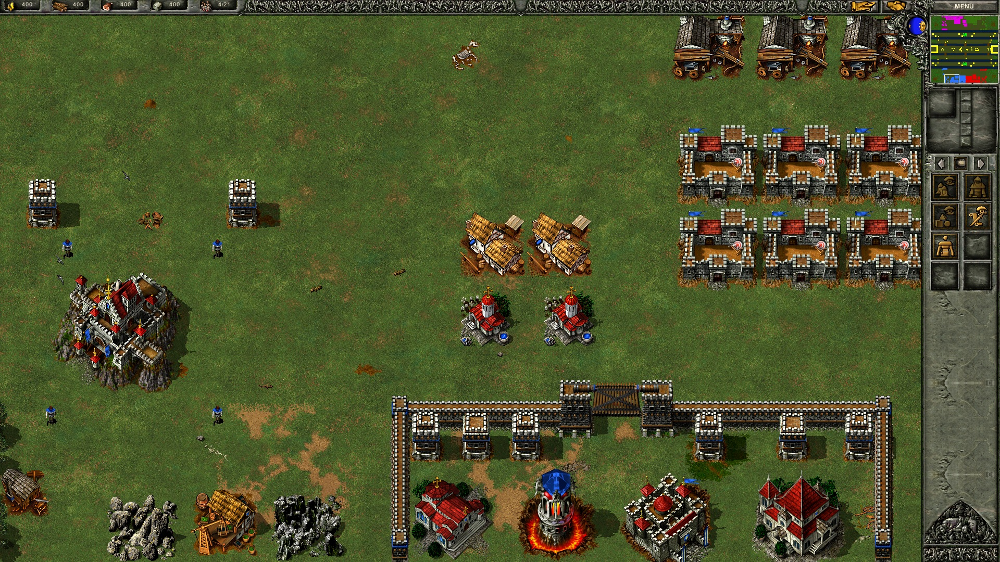
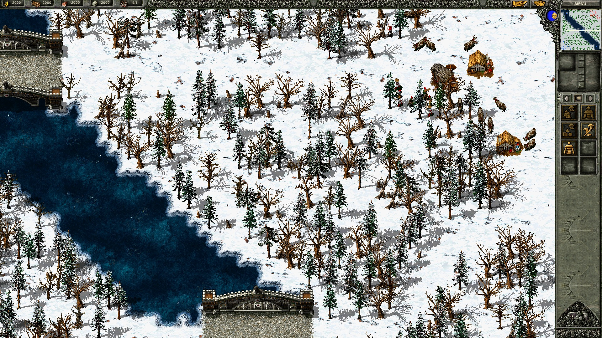
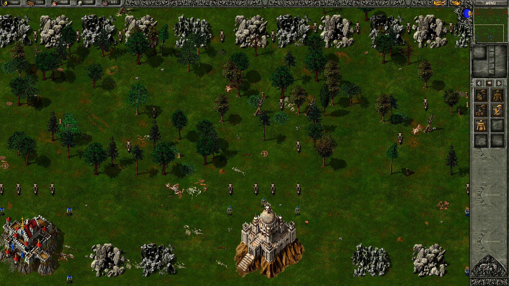
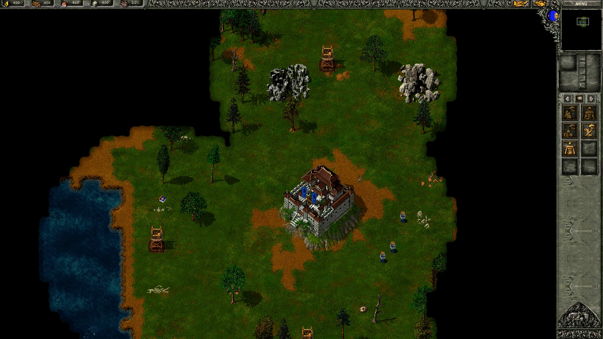
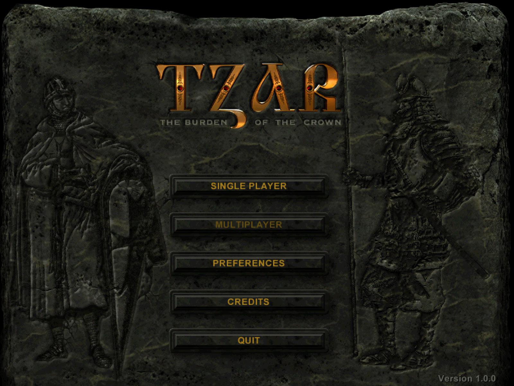

# ReTzar

A fan remake of the classic RTS **Tzar**, rebuilt from scratch in Rust and
Bevy and kept as close to the original as possible.



- All three civilizations, random maps and the campaigns of several
  editions: The Burden of the Crown, Excalibur and King Arthur, Genghis Khan,
  The Domains of Magic, El Cid and the Reconquista
- The original AI, mission scripts, day and night, weather, fog of war
- Runs smoothly on modern Windows, with crisp scaling up to 4K
- Seven languages: English, Italian, French, German, Spanish, Polish, Portuguese
- A few optional extras (smooth zoom, night lights, CRT effect…), all off by default

## Play

The release downloads below are Windows builds. For native macOS or Linux,
see [Experimental macOS support](#experimental-macos-support) and
[Experimental Linux support](#experimental-linux-support).

1. Download the zip of the
   [latest release](https://github.com/ColCarlo/ReTzar/releases/latest) and
   unzip it somewhere of yours, such as the Desktop or Documents.
2. Run `ReTzar.exe` in the `ReTzar` folder. The first time, it asks for the
   folder where Tzar is installed.

Windows may say that it protected your PC, since the game isn't signed:
click **More info**, then **Run anyway**.

| | |
|---|---|
|  |  |
|  |  |

## What you need (Windows)

- Windows 10 or 11 (64-bit), 4 GB of RAM and about 600 MB of disk space
- A graphics card with an up-to-date Vulkan driver
- A copy of Tzar, any edition

## HD packs

ReTzar can draw HD packs: pictures at twice the size in place of the
original art, chosen in **Preferences → Graphics → HD pack**. None is
included: make a personal one from your copy of Tzar with an AI upscaler
(`tools/hd-pack/make-pack.sh`), or draw your own and share it. See
[docs/hd-packs.md](docs/hd-packs.md).

## Build it yourself

For Windows, install [Rust](https://rustup.rs) and Visual Studio 2022 Build
Tools (C++ desktop workload), put the `ReTzar.dat` of the release zip in a `release`
folder here and run `build-release.cmd`.

### Experimental macOS support

Native macOS support has been tested with the **GOG Windows edition of
Tzar: The Burden of the Crown on an Apple M2 Pro**. Steam, CD and other
editions are intended to work, but have not yet been verified on macOS.
The Windows release zip does not contain a macOS executable; build from
this repository's source instead.

1. Install [Rust](https://rustup.rs) and Apple's Command Line Tools
   (`xcode-select --install`). The repository specifies the Rust toolchain
   in `rust-toolchain.toml`.
2. **Install or extract your original Tzar copy first.** ReTzar needs the
   actual game files, not a GOG installer (`setup*.exe` and its `.bin`
   files), a zip, or a disc image. If Tzar is already installed in Whisky
   or Wine, you can use that installation folder or copy the entire Tzar
   folder somewhere accessible, such as the Desktop. Keep its files and
   subfolders together; do not unpack the game's `.wdt` archives.
3. In a terminal opened in this repository, run
   `cargo run --locked --bin retzar`. This builds the native macOS game
   and launches it. In the folder picker, select the **Tzar folder itself**:
   it contains `Maps` and either `DATA` plus `IMAGES` (GOG), or `Packs`.
   Do not select an installer or `Tzar.exe`.

ReTzar remembers that folder in `settings.json`. The original files must
remain accessible. ReTzar runs natively: you do not need to launch
Whisky/Wine or `Tzar.exe`. **Keep `Tzar.exe` in the data folder**, however:
DDV movie decoding reads tables from it. To choose a folder explicitly,
pass `--source "/path/to/Tzar"` after the command's `--` separator:

```sh
cargo run --locked --bin retzar -- --source "/path/to/Tzar"
```

The renderer selects Metal on macOS and Vulkan on other platforms. macOS
plays sound effects, voices and movie soundtracks through Core Audio, and
MIDI music through Apple's General MIDI synthesizer. Original DDV movies
(including those in the GOG release) use the existing Rust decoder.
MP4/MPEG decoding and MP4 conversion use macOS's AVFoundation framework.
No extra media software is needed.

The `retzar-tools` data-pack builder can also run on macOS. Its H.264
encoder uses a bitrate estimate for the requested quality; output is not
byte-identical to Windows encoding. First-run setup reads your installation
directly and does not need to build a pack.

### Experimental Linux support

Native Linux support has been tested with the **GOG Windows edition of
Tzar: The Burden of the Crown on Arch Linux (X11, NVIDIA)**. As on macOS,
build from source; ReTzar reads your Tzar folder directly and remembers it
in `settings.json`, without `ReTzar.dat`.

1. Install [Rust](https://rustup.rs), a C compiler, a Vulkan driver and
   the ALSA headers (`alsa-lib`, `libasound2-dev` on Debian/Ubuntu). For
   the setup dialogs, install `zenity` (or `kdialog` on KDE); for the
   music, a General MIDI SoundFont (`soundfont-fluid` on Arch,
   `fluid-soundfont-gm` on Fedora and Debian/Ubuntu).
2. Install or extract your original Tzar copy first, as for macOS. A Tzar
   installed in Wine, Bottles or Lutris works: choose the folder inside its
   `drive_c` that contains `Maps`.
3. Run `cargo run --locked --release --bin retzar` and choose the Tzar
   folder. Without `zenity` or `kdialog`, pass it on the command line:

```sh
cargo run --locked --release --bin retzar -- --source "/path/to/Tzar"
```

ReTzar opens an X11 window; Wayland desktops run it through XWayland.
Sound effects, voices and movie soundtracks play on the default output
device (ALSA, PipeWire or PulseAudio); MIDI music plays through the
SoundFont found in `/usr/share/soundfonts` or `/usr/share/sounds/sf2`, a
`.sf2` beside the executable, or the one `RETZAR_SOUNDFONT` names. Of the
movies only the original DDV ones play (MP4/MPEG decoding and the
data-pack builder use Windows' and macOS' media frameworks).

## License

Code under [GPL-3.0-or-later](LICENSE). Tzar and all its game data are
© and ™ Haemimont Games, Take-Two Interactive and FX Interactive.
ReTzar is an unofficial fan project.
