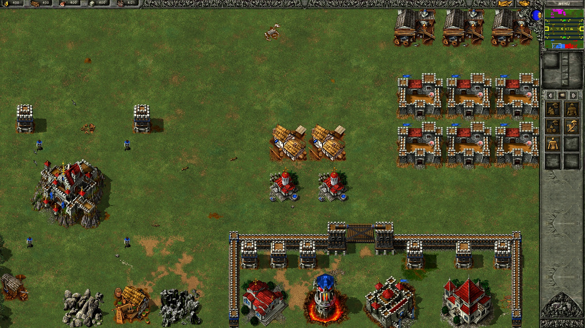
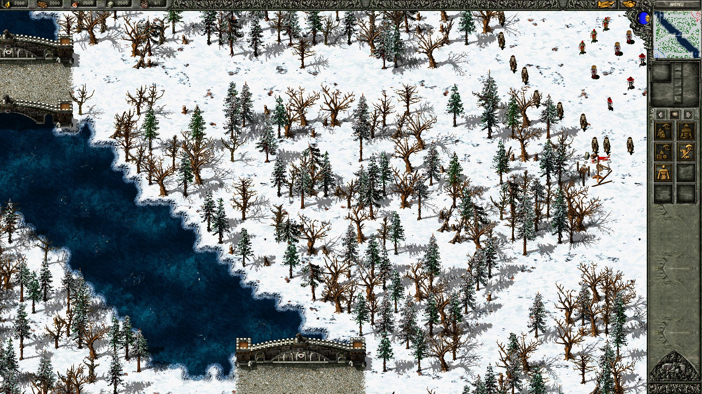
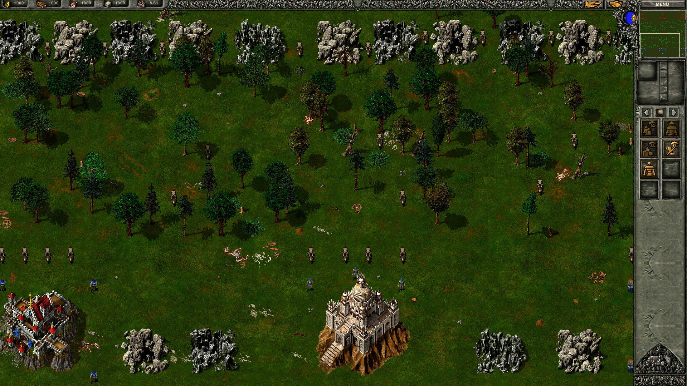
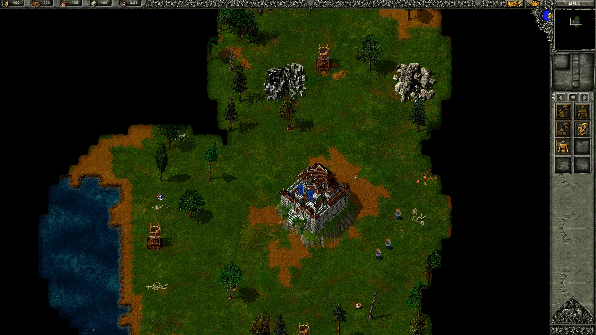
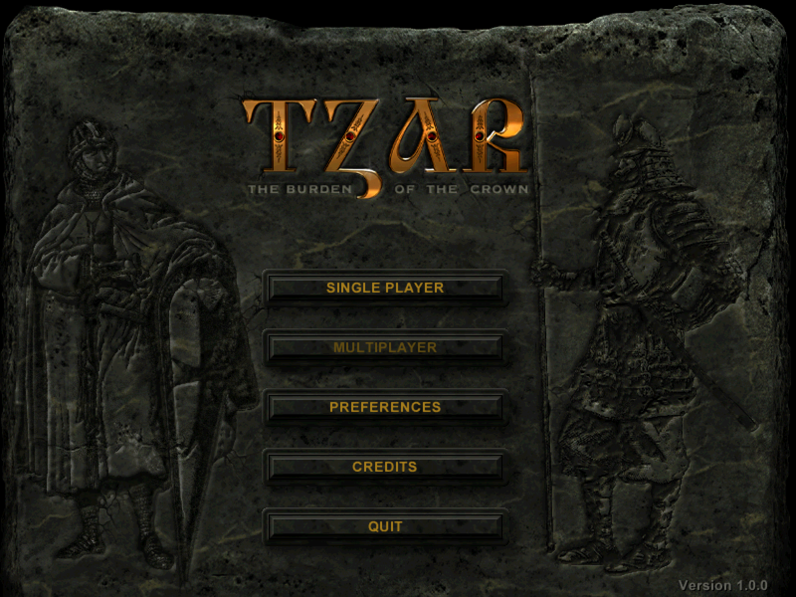

# ReTzar

A fan remake of the classic RTS **Tzar**, rebuilt from scratch in Rust and
Bevy and kept as close to the original as possible.

- All three civilizations, the original campaigns and missions, random maps
- The original AI, mission scripts, day and night, weather, fog of war
- Runs smoothly on modern Windows, with crisp scaling up to 4K
- Seven languages: English, Italian, French, German, Spanish, Polish, Portuguese
- A few optional extras (smooth zoom, night lights, CRT effect…), all off by default

## Play

1. Download `ReTzar-1.0.0-windows.zip` from
   [Releases](https://github.com/ColCarlo/ReTzar/releases/latest) and unzip
   it somewhere of yours, such as the Desktop or Documents.
2. Run `ReTzar.exe` in the `ReTzar` folder. The first time, it asks for the
   folder where Tzar is installed and makes its game data from it, which
   takes about a minute. After that it starts straight away.

Windows may say that it protected your PC, since the game isn't signed:
click **More info**, then **Run anyway**.

| | |
|---|---|
|  |  |
|  |  |

## What you need

- Windows 10 or 11 (64-bit), 4 GB of RAM (the game itself uses about half
  a gigabyte) and about 350 MB of disk space
- A graphics card with an up-to-date Vulkan driver: roughly NVIDIA GeForce
  GTX 600, AMD Radeon HD 7000, Intel HD Graphics 500 or newer
- Your own copy of Tzar, any edition: GOG, Steam, the *Burden of the Crown*
  CD or another one, in any language. ReTzar ships no game data: it makes
  its own data pack from your installation.
  - The movies need a `Tzar.exe` that is not encrypted, as GOG's and
    Steam's are; the old American CD's is, so from it alone the game comes
    without movies.
  - The Italian edition (*Excalibur e il Re Artù*) adds the Excalibur and
    Genghis Khan campaigns; the American CD, copied into `USA\CD\SETUP\Tzar`
    inside it, adds its own campaign and movies.

## Build it yourself

1. Install [Rust](https://rustup.rs) and Visual Studio 2022 Build Tools
   (C++ desktop workload), with a few GB of free disk space.
2. Run `build-release.cmd` with the folder where Tzar is installed, for
   example `build-release.cmd "C:\GOG Games\Tzar"`. If this folder sits
   inside your Tzar installation, `build-release.cmd` alone is enough.

You get a `release` folder with `ReTzar.exe` and `ReTzar.dat`: that's the
whole game, and it can be copied anywhere, even to another PC. The first
time it starts, it asks for the folder where Tzar is installed there (any
edition: CD, GOG or Steam), checks that it holds the original game and
remembers it. Keep a backup of `ReTzar.dat`, since it holds your game data.
With that file in `release`, `build-release.cmd` can rebuild the game even
without the original installation.

## License

Code under [GPL-3.0-or-later](LICENSE). ReTzar is an unofficial fan project,
not affiliated with the makers of Tzar. Tzar and its game data belong to
their owners; the translation files quote the original texts, and the icon
is the original one.
