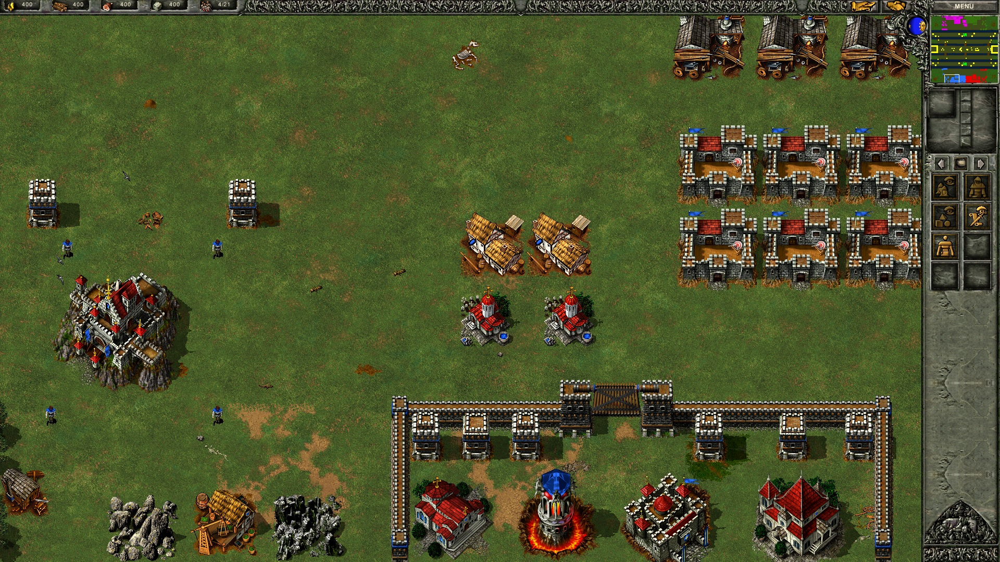
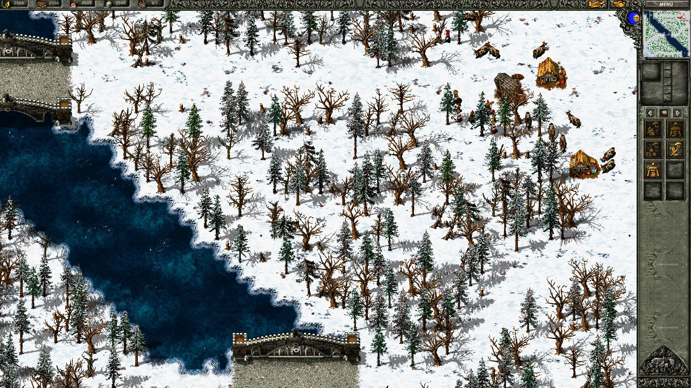
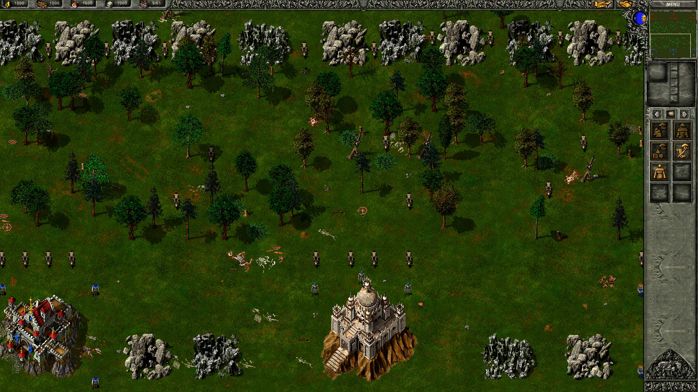
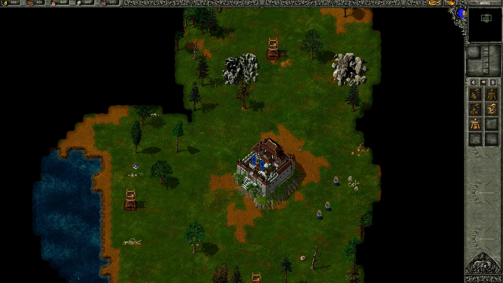
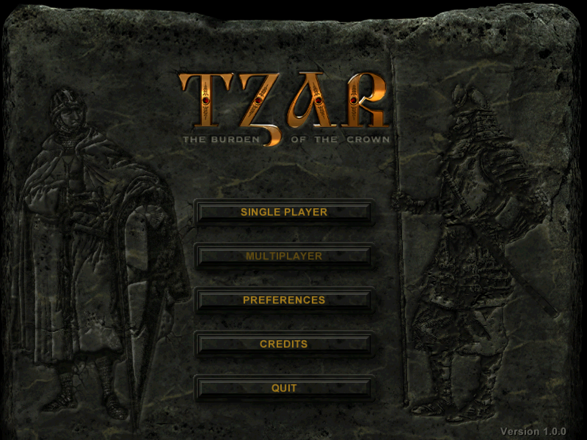

# ReTzar（王冠之争）

经典即时战略游戏 **Tzar（王冠之争）** 的同人重制版，用 Rust 和 Bevy
从零重写，尽量贴近原版。

English (original): [README.md](README.md)



- 三大文明全部在列，随机地图，以及多个版本的战役：王冠之争、亚瑟王与
  神剑（Excalibur and King Arthur）、成吉思汗、魔法领域（The Domains of
  Magic）、埃尔·熙德与收复失地运动（El Cid and the Reconquista）
- 原版 AI、任务脚本、昼夜更替、天气、战争迷雾
- 在现代 Windows 上流畅运行，清晰缩放最高支持 4K
- 八种语言：英语、意大利语、法语、德语、西班牙语、波兰语、葡萄牙语、中文
- 若干可选的附加功能（平滑缩放、夜晚灯光、CRT 滤镜……），默认全部关闭

**QQ 交流群：5981370**（中文玩家交流群，汉化反馈与联机组队都在这里）

## 开始游戏

下面的发布页下载的是 Windows 版本。macOS 原生版请看
[Experimental macOS support](#实验性的-macos-支持)。

1. 从[最新发布页](https://github.com/ColCarlo/ReTzar/releases/latest)下载
   zip 压缩包，解压到你自己的目录里，比如桌面或文档。
2. 运行 `ReTzar` 文件夹里的 `ReTzar.exe`。第一次运行时会询问 Tzar
   安装在哪个文件夹。

Windows 可能会提示"已保护你的电脑"（因为游戏没有数字签名）：点
**更多信息**，再点**仍要运行**。

| | |
|---|---|
|  |  |
|  |  |

## 配置需求（Windows）

- Windows 10 或 11（64 位）、4 GB 内存、约 600 MB 硬盘空间
- 一块装了较新 Vulkan 驱动的显卡
- 任意版本的《Tzar》本体一份

## 自己构建

Windows 上需要安装 [Rust](https://rustup.rs) 和 Visual Studio 2022
Build Tools（C++ 桌面开发工作负载），把发布 zip 里的 `ReTzar.dat` 放到
本目录的 `release` 文件夹里，然后运行 `build-release.cmd`。

### 实验性的 macOS 支持

macOS 原生支持只在 **Apple M2 Pro 上用 GOG Windows 版
Tzar: The Burden of the Crown 测试过**。Steam、CD 和其他版本预期也能
运行，但尚未在 macOS 上验证。Windows 发布包里没有 macOS 可执行文件；
请用本仓库的源码自行构建。

1. 安装 [Rust](https://rustup.rs) 和苹果的 Command Line Tools
   （`xcode-select --install`）。仓库用 `rust-toolchain.toml` 指定
   Rust 工具链版本。
2. **先装好或解出你的原版 Tzar。** ReTzar 需要真实的游戏文件，而不是
   GOG 安装器（`setup*.exe` 和它的 `.bin` 文件）、zip 包或光盘镜像。
   如果 Tzar 已经装在 Whisky 或 Wine 里，可以直接用那个安装目录，或把
   整个 Tzar 文件夹复制到方便的地方（比如桌面）。文件和子文件夹要放在
   一起；不要解开游戏的 `.wdt` 归档。
3. 在本仓库打开终端，运行 `cargo run --locked --bin retzar`。这会构建
   macOS 原生版并启动。在文件夹选择器里选 **Tzar 文件夹本身**：里面应
   有 `Maps`，以及 `DATA` 加 `IMAGES`（GOG 版）或 `Packs`。不要选
   安装器或 `Tzar.exe`。

ReTzar 会把这个文件夹记在 `settings.json` 里。原版文件必须保持可访问。
ReTzar 是原生运行的：不需要再启动 Whisky/Wine 或 `Tzar.exe`。但
**`Tzar.exe` 要留在数据文件夹里**：DDV 动画的解码要从它读表。想显式
指定文件夹，在命令的 `--` 分隔符后面加 `--source "/path/to/Tzar"`：

```sh
cargo run --locked --bin retzar -- --source "/path/to/Tzar"
```

渲染器在 macOS 上选 Metal，其他平台选 Vulkan。macOS 通过 Core Audio
播放音效、语音和动画配音，MIDI 音乐走苹果的 General MIDI 合成器。
原版 DDV 动画（包括 GOG 版里的）用现有的 Rust 解码器。MP4/MPEG 解码
和 MP4 转换用 macOS 的 AVFoundation 框架，不需要额外的媒体软件。

`retzar-tools` 数据打包工具同样能在 macOS 上运行。它的 H.264 编码器
按所需画质估算码率，产物与 Windows 编码不逐字节一致。首次运行的安装
引导直接读取你的游戏安装，不需要预先打包。

## 许可

代码遵循 [GPL-3.0-or-later](LICENSE)。Tzar 及其全部游戏数据的版权
© ™ 归 Haemimont Games、Take-Two Interactive 和 FX Interactive 所有。
ReTzar 是非官方的同人项目。
